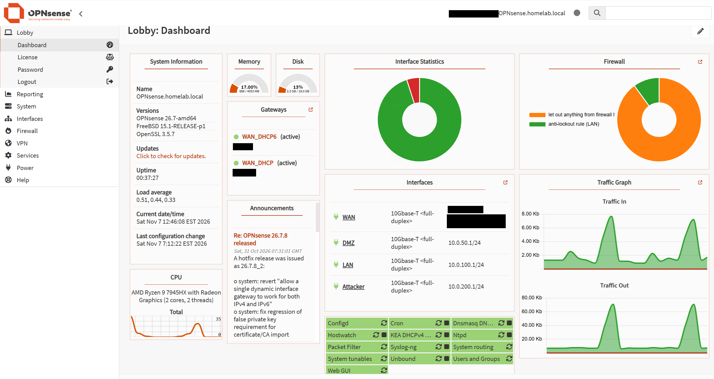

# Enterprise SOC Lab — Module 1: OPNsense & Network Segmentation Architecture

## 1. Executive Summary & Design Rationale

In an enterprise production environment, perimeter protection, granular network segmentation, and centralized logging form the foundation of a Zero Trust architecture. Flat networks are inherently dangerous meaning that a single compromised endpoint or vulnerable server allows adversaries to easily perform lateral movement or escalations across the systems.

This document serves as the primary architectural blueprint and implementation guide for **Module 1** of our Enterprise Security Operations Center (SOC) Lab: **Perimeter Defense and Multi-Zone Network Segmentation via OPNsense**.

```
                                  +------------------------+
                                  |  External / Internet   |
                                  +-----------+------------+
                                              |
                                           [ WAN ]
                                              |
                    +-------------------------+--------------------------+
                    |        OPNsense Core Firewall / Router             |
                    |       (Perimeter Gateway & Routing Engine)         |
                    |   Core Mgmt GW: 10.0.100.1 | DMZ GW: 10.0.50.1     |
                    |   Attacker GW:  10.0.200.1                         |
                    +-------------------------+--------------------------+
                                              |
            +---------------------------------+---------------------------------+
            |                                 |                                 |
 [ Security Mgmt / Core Segment ]     [ DMZ Target Segment ]       [ Red Team / Attack Subnet ]
  VLAN 100 / vtnet2                    VLAN 50 / vtnet1             VLAN 200 / vtnet3
  Subnet: 10.0.100.0/24                Subnet: 10.0.50.0/24         Subnet: 10.0.200.0/24
  Gateway: 10.0.100.1                  Gateway: 10.0.50.1           Gateway: 10.0.200.1
            |                                 |                                 |
   +--------+-----------+            +--------+--------+               +--------+--------+
   |  Ubuntu Server     |            | Windows 11 VM   |               |  Kali Linux VM  |
   | (Splunk Enterprise)|            | 10.0.50.100/24  |               | 10.0.200.50/24  |
   | 10.0.100.10/24     |            +--------+--------+               +-----------------+
   +--------------------+                     |
                                     +--------+--------+
                                     | Metasploitable  |
                                     | 10.0.50.200/24  |
                                     +-----------------+

  Telemetry Pipeline: 
  OPNsense Syslog (UDP 5140) -----------> Splunk Core (10.0.100.10)
  Windows Forwarder (TCP 9997) ----------> Splunk Core (10.0.100.10)
```

### Logical Architecture vs. Physical Hypervisor Implementation

A common point of confusion in virtualized environments is the distinction between **logical network topology** and **physical virtual machine co-location**:

* **Logical Topology (Diagrammed Above):** OPNsense operates at the perimeter as an inline layer-3 router and stateful firewall. It maps virtual interface gateways (`.1`) into each isolated network segment, controlling all packet flows between boundaries.
* **Physical Hypervisor Co-location:** For this environment all of the lab infrastructure, including the OPNsense Firewall VM, Ubuntu/Splunk VM, Windows 11 VM, Metasploitable VM, and Kali VM, resides on the same underlying hypervisor. Isolation is enforced at the hypervisor switch level via virtual bridges / VLANs attached to discrete OPNsense virtual network interfaces (`vtnet0` - `vtnet3`) also including connections to the host machine simulating dedicated management machines.

### Why OPNsense?

OPNsense was selected as the central routing engine and next-generation firewall (NGFW) simulator due to its robust feature set:

* **Hardened FreeBSD Base:** Provides high-throughput packet processing, deterministic kernel routing, and robust stateful packet filtering (`pf`).
* **Multi-Zone Stateful Rules:** Facilitates strict rule definitions per interface, stateful inspection, and granular logging.
* **Structured Remote Syslog (`filterlog`):** Emits detailed connection state changes, block decisions, and pass events over standardized BSD syslog (UDP/TCP), enabling detailed ingestion into Splunk CIM (Common Information Model).
* **Enterprise Equivalence:** Mimics production NGFW implementations (e.g., Palo Alto Networks, Fortinet, or pfSense) in enterprise architectures.


## 2. OPNsense VM Provisioning & Installation

### 2.1 Virtual Machine Configuration
To deploy OPNsense as a perimeter gateway on the hypervisor, an isolated Virtual Machine (VM) was provisioned with dedicated resource allocations and four distinct virtual network interfaces mapped to separate host bridges/vSwitches:

* **CPU & Memory Allocation:** 2 vCPUs | 4 GB RAM (Ensures sufficient throughput for stateful firewall inspection and log processing).
* **Storage Allocation:** 32 GB Virtual Disk (Configured with ZFS filesystem for reliability and crash resilience).
* **Network Interfaces (vNICs):**
  * `vtnet0` (em0) → **WAN Bridge:** Set to NAT/Bridged mode for upstream Internet connectivity.
  * `vtnet1` (em1) → **DMZ Network (`10.0.50.0/24`):** Mapped to custom internal network bridge `vbr1`.
  * `vtnet2` (em2) → **Core Management Network (`10.0.100.0/24`):** Mapped to internal management bridge `vbr2`.
  * `vtnet3` (em3) → **Attacker Network (`10.0.200.0/24`):** Mapped to isolated attack lab bridge `vbr3`.

---

### 2.2 Operating System Installation & Console Setup

1. **ISO Boot & Live Installer Execution:**
   * Attached the official OPNsense ISO (`OPNsense-installer-amd64.iso`) to the VM and booted the system.
   * Logged in using the default live environment credentials (`installer` / `opnsense`) to launch the automated guided setup wizard.

2. **Disk Partitioning & System Installation:**
   * Selected **Guided Installation** using the **ZFS** file system scheme for robust disk integrity and efficient logging I/O.
   * Target disk selected: 32 GB primary virtual drive.
   * Set root password and selected standard system locale (`America/New_York`).
   * Completed installation and rebooted the virtual machine, removing the ISO media.

3. **Interface Assignment & IP Configuration (Console Menu):**
   Upon system reboot, accessed the OPNsense boot console menu to assign interface bindings and set static gateway IP addresses:
   * **Interface Binding Setup:**
     * `WAN` → Mapped to `vtnet0`
     * `LAN` (Core Mgmt) → Mapped to `vtnet2`
     * `OPT1` (DMZ) → Mapped to `vtnet1`
     * `OPT2` (Attacker) → Mapped to `vtnet3`
   * **IP Address Assignment:**
     * **Core Management (`LAN`):** Configured static IP `10.0.100.1/24`. Disabled DHCP server to enforce static addressing on core security assets.
     * **DMZ (`OPT1`):** Renamed to `DMZ` and assigned static IP `10.0.50.1/24`. Disabled DHCP server.
     * **Attacker (`OPT2`):** Renamed to `ATTACKER` and assigned static IP `10.0.200.1/24`. Disabled DHCP server.

---

### 2.3 Initial Web GUI Setup & Hardening

1. **Web Administrative Access:**
   * Connected to the OPNsense Web GUI from an authorized management host on the Core Management network via `https://10.0.100.1`.
   * Completed the OPNsense Setup Wizard: set Hostname (`OPNsense`), Domain (`homelab.local`), and DNS servers.

2. **Gateway & Syslog Export Configuration:**
   * Verified WAN outbound NAT rules were automatically generated to allow internet access for internal subnets.
   * Navigated to **Services > System > Log Settings > Remote Log Targets** and added a custom UDP target:
     * **Target Address:** `10.0.100.10` (Ubuntu Splunk Server)
     * **Target Port:** `5140`
     * **Applications Filtered:** `filterlog` (Firewall state entries)

## 3. Network Topology & Subnetting Architecture

To mirror a corporate infrastructure, the lab is partitioned into four functional zones: WAN, DMZ, Security Management Core, and an isolated Red Team subnet.

### Subnet Allocations & Host Directory

| Segment / Zone | Interface | Subnet CIDR | Gateway IP | Hosted Assets & Roles | Rationale & Security Objectives |
| :--- | :--- | :--- | :--- | :--- | :--- |
| **WAN** | `vtnet0` | Dynamic (DHCP) | Upstream ISP | Outbound Gateway / NAT | Provides Internet reachability for updates while simulating external threat ingress. |
| **Security Mgmt / Core** | `vtnet2` | `10.0.100.0/24` | `10.0.100.1` | • **Ubuntu Server (`10.0.100.10`)**: Hosts Splunk Enterprise SIEM • **OPNsense Mgmt Interface (`10.0.100.1`)**: Firewall WebGUI & Syslog source. | Secure zone housing centralized SIEM and security tools. Isolated from other networks to prevent tampering or unauthorized access. |
| **DMZ Target** | `vtnet1` | `10.0.50.0/24` | `10.0.50.1` | • **Windows 11 VM (`10.0.50.100`)**: Enterprise Workstation Endpoint.<br> • **Metasploitable VM (`10.0.50.200`)**: Vulnerable target host. | Simulates internal enterprise user workstation and vulnerable server environment. Primary target zone for attack telemetry generation. |
| **Red Team / Attack** | `vtnet3` | `10.0.200.0/24` | `10.0.200.1` | • **Kali Linux VM (`10.0.200.50`)**: Threat Actor / Adversary Box. | Dedicated offensive zone to execute adversary emulation (Nmap, Metasploit, Atomic Red Team, etc). Allowed to scan/attack DMZ, but explicitly blocked from Core Management. |

---

## 4. Firewall Rule Implementation & Policy Matrix

To enforce strict zero-trust segmentation between the core infrastructure, the vulnerable DMZ endpoints, and the isolated attacker segment, explicit stateful firewall rules were configured across each OPNsense interface.

### 4.1 Attacker Interface Rules (`ATTACKER` / `10.0.200.0/24`)
The attacker network is constrained to ensure simulated threats can target vulnerable services within the DMZ while remaining strictly isolated from the core SIEM management plane.

| Rule # | Action | Source | Port | Destination | Port | Description |
| :--- | :--- | :--- | :--- | :--- | :--- | :--- |
| **1** | **Block** | Attacker address, Attacker network (`10.0.200.0/24`) | * | LAN address, LAN network (`10.0.100.0/24`) | * | Block Attacker from LAN/Core Management |
| **2** | **Pass** | Attacker address, Attacker network (`10.0.200.0/24`) | * | DMZ address, DMZ network (`10.0.50.0/24`) | * | Allow Attacker to Target DMZ |

---

### 4.2 DMZ Interface Rules (`DMZ` / `10.0.50.0/24`)
The DMZ network hosts high-risk endpoints (Windows 11 and Metasploitable). Traffic originating from the DMZ is restricted to prevent lateral movement toward the core network while permitting necessary DNS, updates, and telemetry forwarding.

| Rule # | Action | Source | Port | Destination | Port | Description |
| :--- | :--- | :--- | :--- | :--- | :--- | :--- |
| **1** | **Block** | DMZ address, DMZ network (`10.0.50.0/24`) | * | LAN address, LAN network (`10.0.100.0/24`) | * | Block DMZ from LAN |
| **2** | **Pass** | DMZ address, DMZ network (`10.0.50.0/24`) | * | * | `domain` (53) | Allow Essential Services (DNS) |
| **3** | **Pass** | DMZ address, DMZ network (`10.0.50.0/24`) | * | * | `http` (80) | Allow Essential Services (HTTP) |
| **4** | **Pass** | DMZ address, DMZ network (`10.0.50.0/24`) | * | * | `https` (443) | Allow Essential Services (HTTPS) |
| **5** | **Pass** | DMZ address, DMZ network (`10.0.50.0/24`) | ICMP | DMZ address (`10.0.50.1`) | * | Allow ICMP Echo Request / Gateway Reachability from DMZ Endpoint |
| **6** | **Pass** | DMZ network (`10.0.50.0/24`) | TCP | `10.0.100.10` (Splunk) | `9997` | Allow Forward Logging to Splunk (Universal Forwarder) |
| **7** | **Block** | DMZ address, DMZ network (`10.0.50.0/24`) | * | * | * | Catch all - Block all |

---

### 4.3 LAN / Core Management Interface Rules (`LAN` / `10.0.100.0/24`)
The core management network houses the Ubuntu server running Splunk Enterprise (`10.0.100.10`). It maintains administrative access across the firewall while blocking unauthorized inbound connections from untrusted segments.

| Rule # | Action | Source | Port | Destination | Port | Description |
| :--- | :--- | :--- | :--- | :--- | :--- | :--- |
| **1** | **Pass** | LAN network (`10.0.100.0/24`) | * | * | * | Default allow LAN to any rule (IPv4) |
| **2** | **Pass** | LAN network (`10.0.100.0/24`) | * | * | * | Default allow LAN to any rule (IPv6) |
| **3** | **Block** | LAN address, LAN network (`10.0.100.0/24`) | * | Attacker address, Attacker network (`10.0.200.0/24`) | * | Block LAN from Attacker |

---

### 4.4 WAN Interface Rules (`WAN`)
- **Default Policy:** Implicit Deny / Drop All. No custom inbound rules are defined, ensuring all unsolicited external traffic from the simulated internet boundary is dropped by default. Outbound NAT is enabled to allow internal segments managed internet access.
---

## 5. OPNsense Logging & Telemetry Configuration

Centralized visibility requires forwarding firewall state decisions directly to Splunk in near real-time.

### Step 1: System Remote Syslog Setup
1. In OPNsense WebGUI, navigate to **System** > **Diagnostics** > **Log Files** > **Settings**.
2. Enable **Remote Syslog**.
3. Add Remote Syslog Server target:
   * **Target Address:** `10.0.100.10`
   * **Port:** `5140`
   * **Protocol:** UDP
   * **Applications:** Firewall Events (`filterlog`), System Events.

### Step 2: Log Format Standard (`filterlog`)
OPNsense emits comma-separated values (CSV) within standard BSD syslog headers. The output fields follow this structure:
```text
rule_number,sub_rule_number,anchor,tracker,interface,reason,action,direction,ip_version,tos,ecn,ttl,id,offset,flags,protocol_id,protocol,length,src_ip,dest_ip,src_port,dest_port
```

---

## 6. Architectural Verification & Security Validation

To ensure the firewall configuration fulfills its design goals prior to any simulation, baseline validation checks were performed across the active infrastructure components:

1. **Active Inter-VLAN Isolation & Reachability Verification:**
   * **Core Management to DMZ Gateway Reachability:** Ping from Splunk Server (`10.0.100.10`) to DMZ Gateway (`10.0.50.1`): **SUCCESS** (Verified fundamental Layer 3 routing across OPNsense interfaces).
   * **Core Management to DMZ Endpoint Verification:** Ping from Splunk Server (`10.0.100.10`) to Windows 11 DMZ Endpoint (`10.0.50.100`): **SUCCESS** (Verified cross-zone policy rule **POL-01** allowing authorized management traffic into the DMZ).
   * **Unsolicited Cross-Zone Boundary Check:** Verified default-deny inbound rules blocking non-explicitly permitted connections between non-management zones.

2. **Telemetry Transmission & SIEM Ingestion Check:**
   * Queried the Splunk Enterprise Web UI (`Search & Reporting`) to confirm active log parsing and data ingestion:
     ```spl
     index=* sourcetype="opnsense:filterlog"
     ```
   * **Result:** Confirmed real-time ingestion of raw syslog UDP packets originating from the OPNsense gateway (`10.0.100.1`).
   * **Field Extraction & CIM Compliance:** Verified that incoming data streams automatically parse into Common Information Model (CIM) compliant fields (`action`, `src_ip`, `dest_ip`, `dest_port`) via the `TA-opnsense` add-on.

3. **Pending Validation (Attacker Segment):**
   * *Note:* Validation of Kali Linux routing (rules **POL-04** and **POL-05**) will be performed during the upcoming Threat Simulation phase once the Kali guest instance is fully provisioned into this environment.

---

## 7. Summary & Next Steps

Module 1 successfully establishes a hardened, segmented network infrastructure with complete firewall logging. 



* **Next Document (Module 2):** *Splunk SIEM Enterprise Deployment, Index Design, Data Ingestion Pipelines, and Parsing (`TA-opnsense` & Universal Forwarder Configuration).*