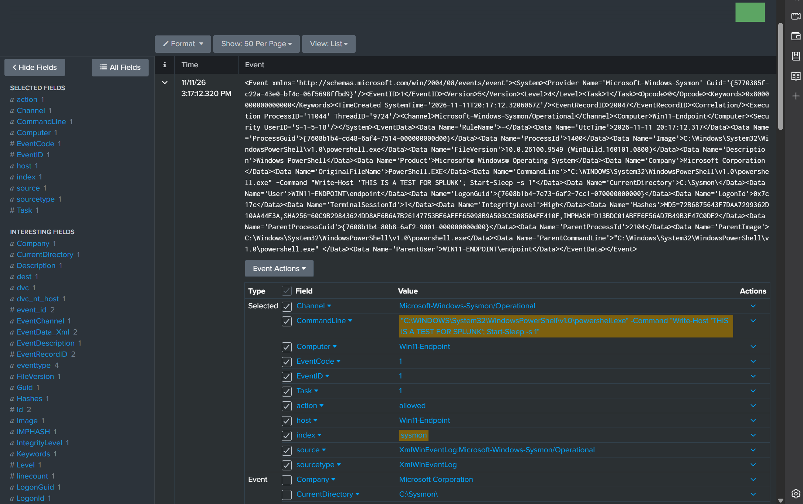
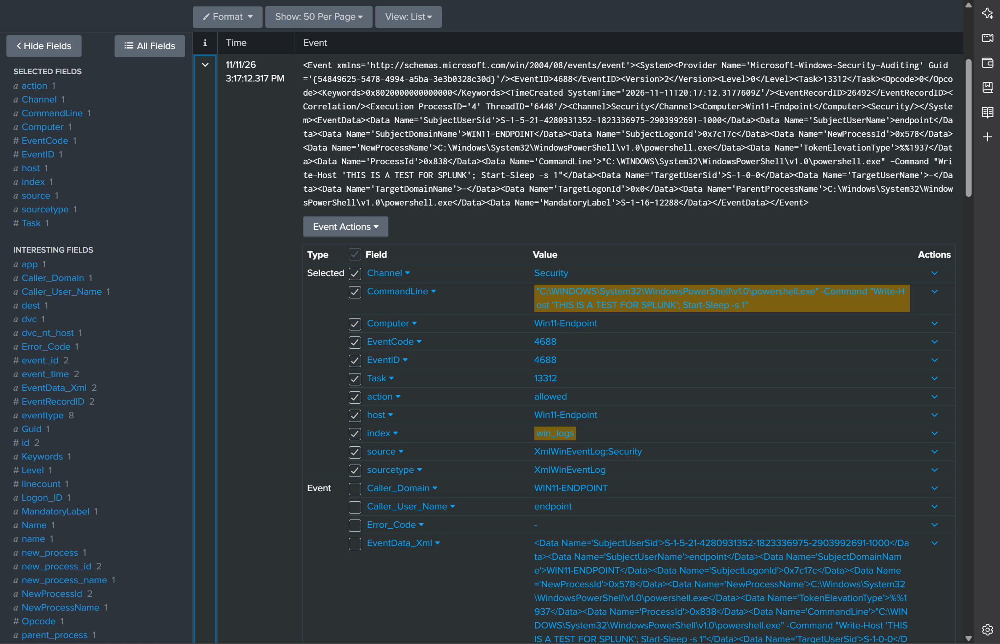

# Module 3: Windows Endpoint Provisioning, Sysmon & Universal Forwarder Configuration

## 1. Executive Summary & Core Objectives

In this module, I focused on provisioning and onboarding a Windows 11 Enterprise endpoint (`10.0.50.100`) inside of the DMZ network segment of my SOC lab environment. 

To achieve enterprise-grade visibility and detect advanced adversary techniques, default Windows logging would be insufficient. This phase involved:
* Provisioning a Windows 11 Enterprise virtual machine in VirtualBox inside of the DMZ subnet (`10.0.50.0/24`).
* Configuring advanced local Windows audit policies to capture critical security events, including command-line execution and PowerShell script block logging.
* Deploying Sysmon (System Monitor) configured with the industry-standard **SwiftOnSecurity** XML template to capture better crafted network telemetry.
* Installing and configuring the **Splunk Universal Forwarder (UF)** to securely stream structured event logs and Sysmon telemetry over TCP `9997` to my central Splunk SIEM indexer (`10.0.100.10`).
* Validating end-to-end endpoint telemetry ingestion and searchability within Splunk Enterprise.

---

## 2. Windows 11 Enterprise Provisioning & Network Configuration

### 2.1 VirtualBox Hardware & Network Architecture
I deployed the Windows endpoint onto an isolated virtual machine (`Windows-Endpoint`) configured to simulate a corporate user workstation situated inside the DMZ perimeter zone.

* **Compute Allocation**: 4 vCPUs, 6 GB RAM, 60 GB Virtual Disk (Dynamic Allocation).
* **Network Topology**:
  * **Adapter 1**: Internal Network / DMZ Bridge (`vbr1` / `10.0.50.0/24`).

### 2.2 Static IP & Gateway Configuration
To ensure reliable telemetry forwarding and prevent IP disruptions across network state changes, I assigned a static IPv4 configuration:
* **IP Address**: `10.0.50.100`
* **Subnet Mask**: `255.255.255.0` (`/24`)
* **Default Gateway**: `10.0.50.1` (OPNsense DMZ Interface)
* **DNS Servers**: `1.1.1.1`, `8.8.8.8`

---

## 3. Advanced Windows Audit Policy Configuration

Default Windows Security Event Log policies omit critical forensic data such as process command-line arguments and script execution blocks. To capture high-fidelity adversary indicators, I configured advanced audit policies via Local Group Policy (`secpol.msc`).

### 3.1 Targeted Audit Categories
1. **Detailed Tracking > Audit Process Creation (Event ID 4688):** Enabled inclusion of command-line arguments in process creation events to detect hidden execution or payload staging.
2. **Account Logon / Logon (Event IDs 4624, 4625, 4634):** Enabled success and failure auditing for logon sessions.
3. **DS Access / Object Access / Policy Change:** Configured baseline tracking for privilege usage and security policy modifications.
4. **PowerShell Script Block Logging (Event ID 4104):** Enabled via Group Policy (`Administrative Templates > Windows Components > Windows PowerShell`) to capture full script blocks executed in memory, mitigating fileless PowerShell attacks.

---

## 4. Sysmon (System Monitor) Installation & SwiftOnSecurity Configuration

### 4.1 Architecture & Design Rationale
While native Windows event logs track high-level administrative and logon states, they lack deep kernel-level visibility into process injection, network connections, raw disk reads, and driver loads. 

To bridge this gap, I deployed **Microsoft Sysmon (System Monitor)**. Rather than using default logging, which generates massive noise and resource consumption, I integrated the hardened **SwiftOnSecurity** configuration template. This ruleset cleans the data streams while prioritizing high-value adversary indicators (e.g., PsExec execution, reflective DLL injection, unexpected network connections from unsigned binaries) which are helpful details when mapping to MITRE ATT&CK.

### 4.2 Deployment Procedure
To deploy and register Sysmon with the hardened ruleset, I did the following:
* Placed the Sysinternals Sysmon binaries into `C:\Program Files\Sysmon`.
* Placed the SwiftOnSecurity configuration file (`sysmonconfig-export.xml`) in the working directory.
* Installed and registered Sysmon from an elevated PowerShell prompt using the command below:
```powershell
.\Sysmon64.exe -i sysmonconfig-export.xml -accepteula
```
* Verified successful service startup and operational status using `Get-Service Sysmon64`.

---

## 5. Splunk Universal Forwarder (UF) Deployment & Telemetry Routing

### 5.1 Universal Forwarder Installation
I installed the **Splunk Universal Forwarder** MSI package onto the Windows 11 endpoint, specifying the central indexer address during setup:
* **Deployment Server:** None (Standalone lab configuration).
* **Receiving Indexer:** `10.0.100.10:9997`

### 5.2 Configuring `outputs.conf`
To ensure encrypted and reliable TCP forwarding over port `9997` to my Ubuntu Splunk indexer, I configured `C:\Program Files\SplunkUniversalForwarder\etc\system\local\outputs.conf`:
```ini
[tcpout]
defaultGroup = primary_indexers

[tcpout:primary_indexers]
server = 10.0.100.10:9997
```

### 5.3 Configuring `inputs.conf` for Log Collection
I configured `C:\Program Files\SplunkUniversalForwarder\etc\system\local\inputs.conf` to target key Windows channels and Sysmon operational logs:
```ini
[default]
host = Windows-Endpoint

[WinEventLog://Security]
disabled = 0
renderXml = true
source = XmlWinEventLog:Security
index = win_logs

[WinEventLog://Microsoft-Windows-Sysmon/Operational]
disabled = 0
renderXml = true
source = XmlWinEventlog:Microsoft-Windows-Sysmon/Operational
index = sysmon
```

**Note:** I configured these files this way because I installed two add-ons on my Splunk instance **(Splunk Add-on for Sysmon and Splunk Add-on for Microsoft Windows)** so it can parse the XML logs and extracts the fields allowing me to work in a more efficient manner.

After finalizing configuration changes, I restarted the forwarder service to apply the pipeline:
```powershell
Restart-Service SplunkForwarder
```

---

## 6. End-to-End Pipeline & Telemetry Verification

To ensure the data was successfully flowing through the network and indexing on the central SIEM, I performed end-to-end checks:

### 6.1 Forwarder Service & Network Check
1. Verified running forwarder service state:
   ```powershell
   Get-Service SplunkForwarder
   ```
2. Verified active TCP connection from the Windows endpoint (`10.0.50.100`) to the Splunk Indexer (`10.0.100.10:9997`):
   ```powershell
   Test-NetConnection -ComputerName 10.0.100.10 -Port 9997
   ```

### 6.2 Splunk Search & Ingestion Validation
I validated that the pipeline was working by generating an event through the Windows endpoint PowerShell terminal:  
  
```PowerShell
powershell.exe -Command "Write-Host 'THIS IS A TEST FOR SPLUNK'; Start-Sleep -s 1"
```

1. I opened Splunk Web on my Ubuntu server (`https://10.0.100.10:8000`), navigated to **Search & Reporting**, and executed one query to look for this event on the `win_logs` index which is the one coming from windows logs:
    ```spl
    index=win_logs CommandLine="*THIS IS A TEST FOR SPLUNK*"
    ```

    

2. To confirm the `sysmon`pipeline I executed a similar query pointed towards its index:
    ```spl
    index=sysmon CommandLine="*THIS IS A TEST FOR SPLUNK*"
    ```

      

 **Results:** Confirmed real-time ingestion, parsing and field extraction of Windows Security and Sysmon event logs.

---


## 7. Deployment State Summary

| Component | Configuration Parameter | Operational Status |
 --- | :--- | :--- |
| **Endpoint Host IP** | `10.0.50.100` (Static DMZ) | Active |
| **Advanced Auditing** | Process Creation (4688 w/ CLI), PowerShell (4104) | Enabled |
| **Sysmon EDR Engine** | Sysmon v15+ w/ SwiftOnSecurity XML | Active & Monitoring |
| **Forwarder Agent** | Splunk Universal Forwarder | Forwarding via TCP `9997` |
| **Target Index** | `sysmon` index on `10.0.100.10` | Receiving & Indexing Telemetry |