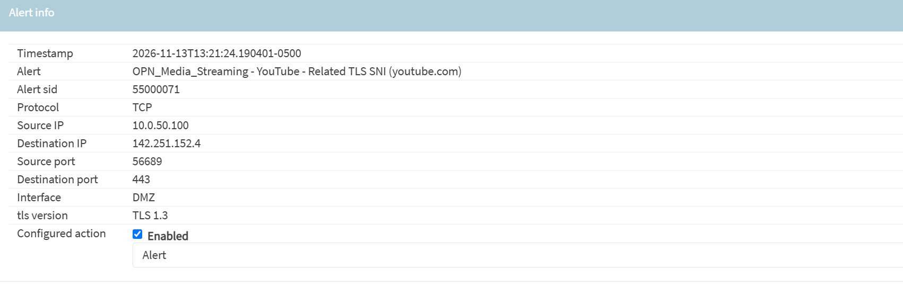
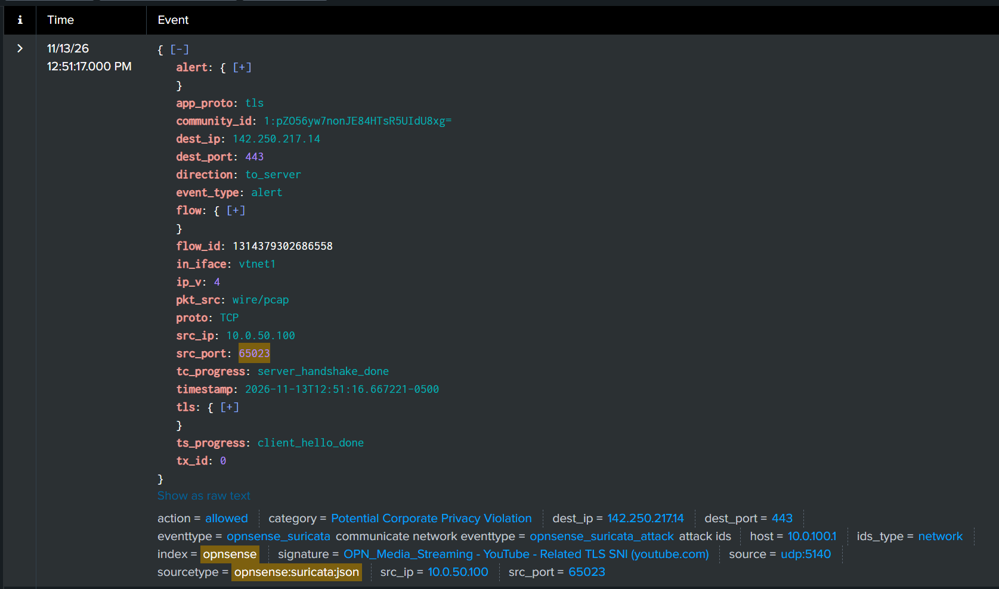

# Module 4: Suricata IDS Deployment & Splunk Telemetry Integration

## 1. Executive Summary & Core Objectives

In this module, I focused on deploying, configuring, and integrating a network-based Intrusion Detection System (IDS) utilizing **Suricata** directly onto the OPNsense perimeter firewall (`10.0.100.1`), and routing its structured telemetry into Splunk Enterprise (`10.0.100.10`).

While Modules 1 through 3 established multi-zone network segmentation, centralized SIEM ingestion, and host-level endpoint telemetry via Sysmon, perimeter firewall rules alone (`filterlog`) only track Layer 3/4 connection states (source/destination IPs and ports). Without Deep Packet Inspection (DPI), malicious payloads traversing permitted ports (such as HTTP/HTTPS or DNS) remain invisible at the network layer.

This phase involved:
* Configuring Suricata in passive, non-blocking **IDS mode** (`PCAP live mode`) across segmented virtual interfaces to inspect network traffic without dropping packets during adversary simulations.
* Enabling **Promiscuous mode** to ensure complete packet visibility across virtualized bridges.
* Optimizing the pattern-matching inspection engine using **Hyperscan**.
* Provisioning and activating Emerging Threats (`ET open`) detection rulesets targeting malware, exploits, network reconnaissance, and post-exploitation indicators.
* Configuring **EVE JSON** remote syslog streaming from OPNsense to Splunk Enterprise (`index=opnsense`) for automated field extraction and structured SIEM correlation.
* Validating end-to-end network intrusion detection by generating test traffic and verifying parsed JSON fields inside Splunk.

---

## 2. Suricata IDS Architecture & Core Configuration

### 2.1 General Settings & Interface Scope
To achieve complete visibility across the lab's segmented zones without disrupting simulated attacker traffic, I configured Suricata via the OPNsense Web GUI (**Services > Intrusion Detection > Administration > Settings**):

* **Enabled:** *Checked* (Activates the Suricata IDS daemon).
* **Capture Mode:** `PCAP live mode (IDS)`. Operates passively as a pure Intrusion Detection System rather than an inline blocking IPS. This ensures simulated attacks reach the DMZ targets to generate both network and endpoint telemetry.
* **Promiscuous Mode:** *Checked*. Forces the virtual network interfaces to pass all observed frames on the bridge segment to the Suricata engine, regardless of destination MAC address.
* **Interfaces:** Selected `Attacker`, `DMZ`, and `LAN`, to ensure full coverage traffic inspection across all virtual networks. For this lab `WAN` was not included to prevent duplicated logs.

### 2.2 Detection Engine Optimization (`Hyperscan`)
Under the **Detection** section, I configured the **Pattern matcher** algorithm to **Hyperscan**:
* **Rationale:** Unlike standard algorithms (such as basic Aho-Corasick) that inspect signatures sequentially and consume higher memory overhead, Hyperscan utilizes Intel SIMD (Single Instruction, Multiple Data) CPU vector extensions to scan packet payloads against thousands of regular expressions and signatures in parallel. This minimizes inspection latency across the virtualized OPNsense firewall.

---

## 3. Logging Pipeline & EVE JSON Design Rationale

### 3.1 Logging Configuration
Under the **Logging** section in Suricata settings, I enabled eve syslog output leaving the standard syslog streaming off:

* **Enable syslog alerts:** *UnChecked*. Was configured this way to prevent duplicated logs and reduce workload.
* **Enable eve syslog output:** *Checked*. Sends structured **EVE JSON** (Extensible Event Format) logs into the OPNsense remote syslog pipeline destined for the Ubuntu Splunk indexer (`10.0.100.10:5140`).
* **Rotate log:** `Weekly` | **Save logs:** `4`. Manages local firewall disk utilization.

### 3.2 Why EVE JSON for Splunk Integration?
Traditional syslog alerts arrive as unstructured text strings, requiring complex, brittle Regular Expressions (Regex) at search time to isolate IP addresses, ports, and signature metadata. 

Enabling **EVE JSON** formats every network event into explicit key-value pairs before transmission:

```json
{
  "timestamp": "2026-11-11T20:37:00.123456-0500",
  "event_type": "alert",
  "src_ip": "10.0.50.100",
  "src_port": 54321,
  "dest_ip": "192.168.1.1",
  "dest_port": 80,
  "proto": "TCP",
  "alert": {
    "action": "allowed",
    "signature_id": 2013028,
    "signature": "ET POLICY Python-urllib/ User-Agent Detected",
    "category": "Attempted Information Leak",
    "severity": 2
  }
}
```
>*Note: This block is a generic example*

Because Splunk Enterprise natively parses JSON structures upon ingestion alongside `TA-opnsense`, the fields are automatically extracted and indexed. This allows for clean SPL querying, dashboarding, and cross-correlation with Windows Sysmon logs without writing manual field extractions.


---

## 4. Threat Signature & Ruleset Management

### 4.1 Emerging Threats (`ET open`) Selection
To detect realistic adversary TTPs while avoiding excessive benign operational noise, I navigated to **Services > Intrusion Detection > Download** and provisioned the following Rulesets:

| Ruleset Category | Detection Focus & SOC Rationale |
| :--- | :--- |
| **`ET open/emerging-malware`** | Identifies known malware payloads, Command-and-Control (C2) beaconing, and malicious binary downloads. |
| **`ET open/emerging-exploit`** | Detects targeted exploitation attempts against specific software vulnerabilities and service flaws. |
| **`ET open/emerging-exploit_kit`** | Identifies automated exploit kit landing pages, obfuscated redirects, and drive-by download frameworks. |
| **`ET open/emerging-scan`** | Captures active network reconnaissance, including Nmap SYN/UDP port scans, service enumeration, and host sweeps. |
| **`ET open/emerging-attack_response`** | Flags post-exploitation indicators such as unauthorized reverse shell traffic and anomalous outbound administrative responses. |
| **`ET open/emerging-user_agents`** | Detects suspicious HTTP User-Agent strings associated with automated offensive tools (`curl`, `wget`, Python scripts, Metasploit). |
| **`OPNsense-App-detect/media-streaming`** | Identifies application-layer media streaming traffic to generate non-destructive telemetry and verify end-to-end network IDS pipeline functionality. |

### 4.2 Ruleset Activation & Policy Application
1. Clicked **Download & Update Rules** in the **Download** tab to pull the latest signature definitions from the Emerging Threats repository.
2. Navigated to the **Rules** tab, confirmed the downloaded rulesets were toggled to **Enabled**, and clicked **Apply** to load the signatures into the active Suricata engine.

---

## 5. End-to-End Pipeline Verification & Testing

To validate that Suricata was actively inspecting traffic, triggering rules, and streaming clean JSON streams into Splunk without requiring live malware execution, I performed a controlled validation test:

### 5.1 Synthetic Detection Trigger (`media-streaming`)
1. Enabled the **`OPNsense-App-detect/media-streaming`** ruleset under **Services > Intrusion Detection > Download** and applied the configuration.
2. From the Windows 11 DMZ endpoint (`10.0.50.100`), generated outbound HTTPS streaming traffic by navigating to a video streaming platform.

### 5.2 Local Firewall Alert Verification
1. Navigated to **Services > Intrusion Detection > Alerts** in the OPNsense Web GUI and clicked **Refresh**.
2. Confirmed that Suricata generated immediate alert entries displaying the `App-detect media-streaming` signature with the Windows 11 host IP (`10.0.50.100`) recorded as the source address.


### 5.3 Splunk EVE JSON Ingestion & Field Extraction Check
1. Logged into Splunk Web (`https://10.0.100.10:8000`) and opened **Search & Reporting**.
2. Executed the following Search Processing Language (SPL) query targeting the `opnsense` index:

    ```spl
    index=opnsense sourcetype="opnsense:suricata:json"
    ```

3. **Results:** Confirmed real-time ingestion of Suricata EVE JSON events. Verified in the left-hand **Fields** sidebar that all JSON key-value pairs parsed cleanly and were immediately searchable.


---

## 6. Deployment State Summary

| Component | Configuration Parameter | Operational Status |
| :--- | :--- | :--- |
| **IDS Engine** | Suricata (`PCAP live mode` / Non-blocking) | Active & Monitoring |
| **Interface Scope** | `Attacker`, `DMZ`, `LAN` (Promiscuous Mode ON) | Active |
| **Pattern Matcher** | `Hyperscan` (SIMD Parallel Inspection) | Active |
| **Threat Signatures** | `ET open` (Malware, Exploit, Exploit Kit, Scan, Attack Response, User Agents, Media Streaming) | Downloaded & Enabled |
| **Telemetry Format** |`EVE JSON` Syslog Output | Streaming to `10.0.100.10:5140` |
| **SIEM Integration** | Splunk `index=opnsense` (`sourcetype=opnsense:suricata:json*`) | Indexing & Extracting JSON Fields |