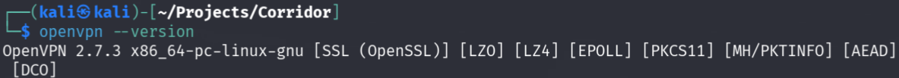
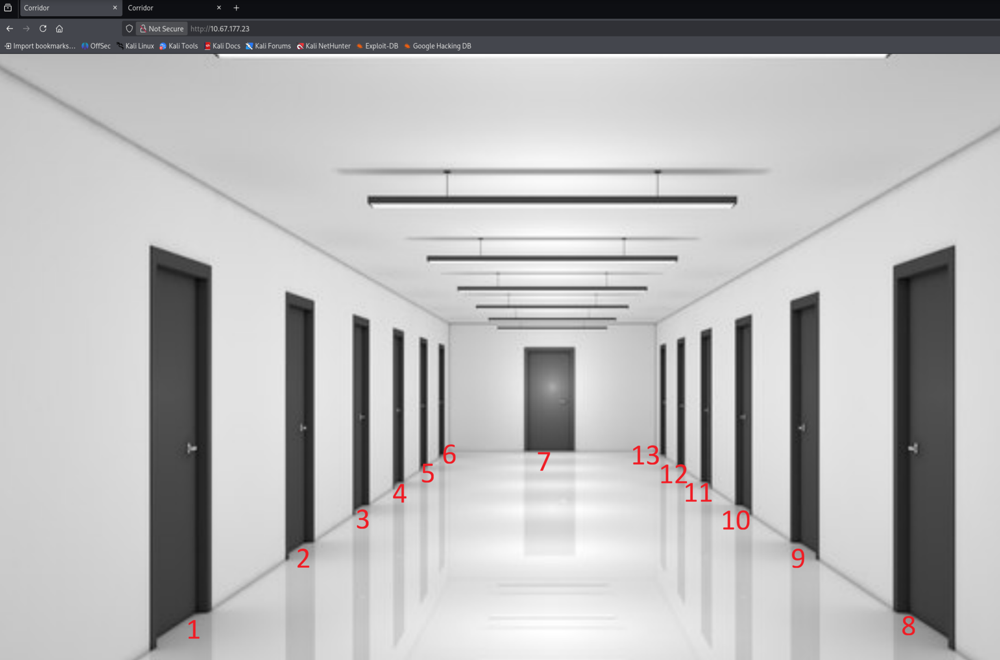

# Corridor — Web Path Enumeration & Cryptographic Hash Analysis

## Briefing

According to OWASP Cheat Sheet Series Insecure Direct Object Reference (IDOR) is a vulnerability that arises when attackers can access or modify objects by manipulating identifiers used in a web application's URLs or parameters. It occurs due to missing access control checks, which fail to verify whether a user should be allowed to access specific data.

---

## Metadata & Environment
* **Target Environment:** TryHackMe Corridor Room (Lab IP: `10.67.177.23`)
* **Attacker Host:** Kali Linux (VirtualBox)
* **Tools:** OpenVPN, Firefox, Name That Hash (nth), John the Ripper, md5sum

---

## 1. Reconnaissance & Staging

### VPN Connection & Reachability
* **Objective:** Establish a secure connection to the TryHackMe private network and verify routing to the target lab machine.
* **Execution:**
  * Verified local OpenVPN installation:
    ```bash
    openvpn --version
    ```



* Established the tunnel using the downloaded configuration:
    ```bash
    sudo openvpn filename.ovpn
    ```
  * Verified connectivity via ICMP ping:
    ```bash
    ping -c 3 10.67.177.23
    ```
  * **Result:** Tunnel successfully initialized and ping responses confirmed host reachability.

---

## 2. Enumeration & Application Analysis

* **Initial Discovery:** Navigating to `http://10.67.177.23/` via Firefox reveals an interface displaying a corridor with 13 doors.

  

* **Observation:** Clicking on the doors routes the user to empty rooms, each containing a unique identifier in the URL path. For example:
  * First door to the left: `http://10.67.177.23/c4ca4238a0b923820dcc509a6f75849b`
  * Middle door: `http://10.67.177.23/8f14e45fceea167a5a36dedd4bea2543`
* **Analysis:** The URL parameters look very similar to cryptographic hash strings rather than standard sequential integer IDs.

---

## 3. Cryptographic Analysis & Hash Identification

* **Recognition:** To determine the hashing algorithm governing the URL paths, the `Name That Hash` (`nth`) utility was utilized:
  ```bash
  nth -t c4ca4238a0b923820dcc509a6f75849b
  ```

**Finding:** The analysis confirmed the format is an `MD5 hash`.

**Processing:** A text file `hash.txt` was created containing the extracted hashes for each visible door.

`John the Ripper` was used against the MD5 hashes to map the strings back to their plaintext inputs:

```Bash
john --format=raw-md5 hash.txt
```

**Results inspection:**

```Bash
john --show --format=raw-md5 hash.txt
```



**Finding:** The hashes correspond directly to sequential integer values (representing door numbers 1 through 13).

## 4. Exploitation & Flag Verification

* **Hypothesis:** Given that the visible doors map to sequential integers (1–13), the challenge objective ("Can you find your way back to where you came?") implies the existence of an origin (integer `0`) or an adjacent path (`14`).
* **Payload Generation:** Computed the MD5 hashes for integers `0` and `14` using the terminal:
  ```bash
  # Generate hash for 14
  echo -n "14" | md5sum

  # Generate hash for 0
  echo -n "0" | md5sum
  ```

**Testing Both Paths:**

Testing path **14** `ab3238922bcc25a6f606eb525ffdc56`: Returned a not found state.


Testing path **0** `cfcd208495d565ef66e7dff9f98764da`: Successfully resolved and revealed the `flag`.


