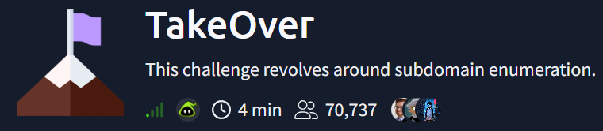
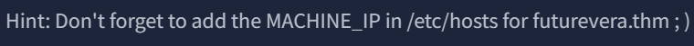
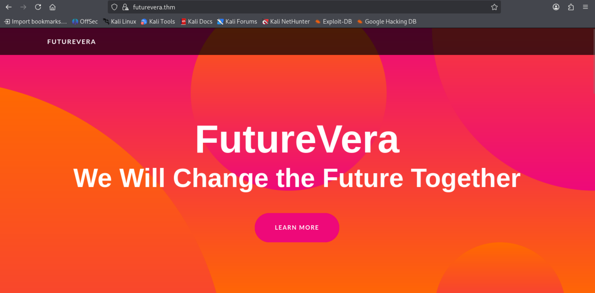
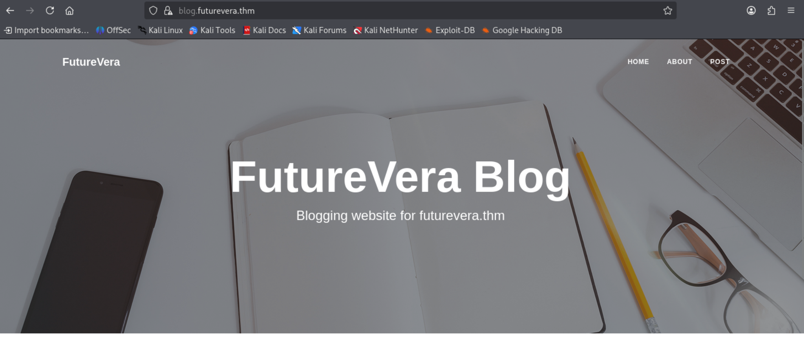
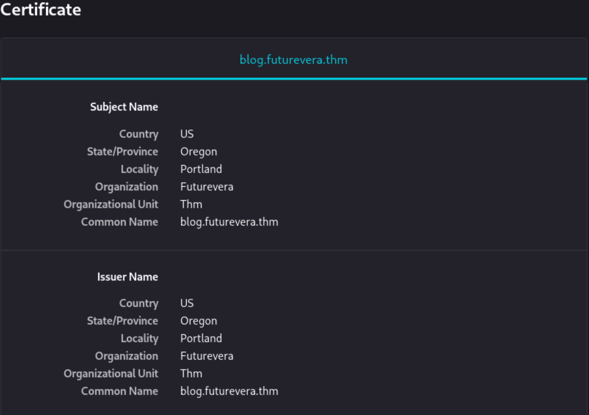
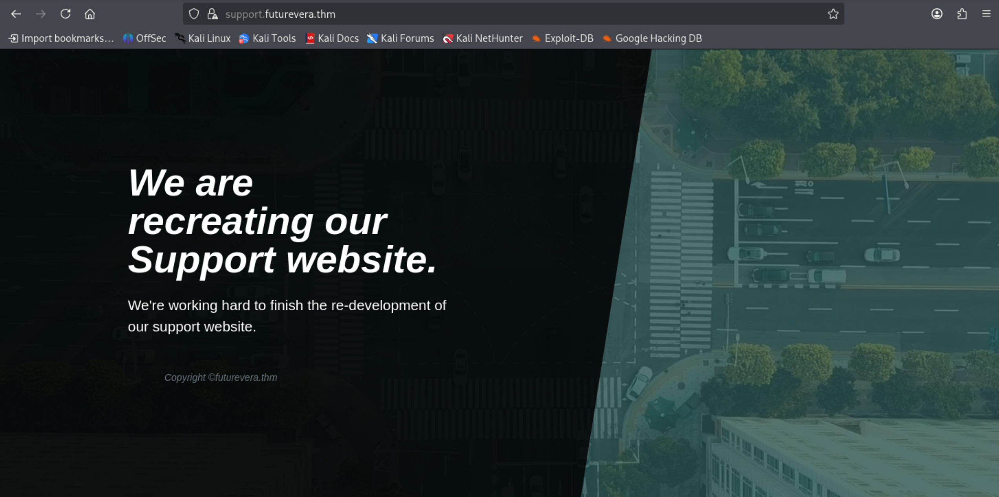
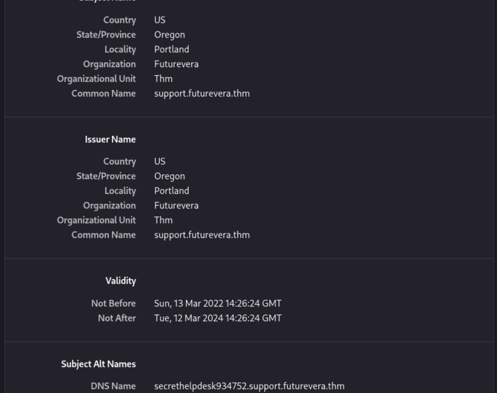

# Technical Walkthrough: TryHackMe – TakeOver



## Room Overview & Objectives
* **Challenge Name:** TakeOver
* **Objective:** Perform active subdomain enumeration and attack surface mapping to uncover misconfigured web assets and capture the flag.
* **Framework Alignment:** OWASP Web Security Testing Guide (WSTG) – Reconnaissance and Subdomain Enumeration.
* **Tools Utilized:** Kali Linux, VirtualBox, OpenVPN, Nmap, Firefox, Gobuster.

---

## Executive Introduction
According to the **OWASP Web Security Testing Guide (WSTG)**, subdomain enumeration is a critical reconnaissance practice defined as the process of discovering hostnames and subdomains beneath a root domain to map an organization’s complete attack surface, expose unknown or forgotten web applications, and identify entry points vulnerable to attacks like subdomain takeover.

---

## Phase 1: Environment Staging & Name Resolution

**VPN Connectivity:** Established a secure connection between the attacker environment (Kali Linux on VirtualBox) and the TryHackMe target network using OpenVPN:

```bash
sudo openvpn filename.ovpn
```

**Local Host Resolution:** Attempting to browse directly to https://futurevera.thm resulted in a connection error because isolated CTF domains do not resolve via public DNS. Following the lab prompt hint, the target IP and domain mapping were added to /etc/hosts:



```bash
sudo vi /etc/hosts
```

**Added mapping:** <MACHINE_IP> futurevera.thm

**Initial Verification:** Navigating to https://futurevera.thm in Firefox successfully loaded the landing page, confirming basic HTTPS connectivity and proper local name resolution:



## Phase 2: Initial Attack Surface Reconnaissance
To get a better picture of the attack surface, a port scan was executed:

```Bash
sudo nmap -p- --open futurevera.thm
```

Scan Results:
1. **Port 22/tcp (SSH):** Remote administrative access.

2. **Port 80/tcp (HTTP):** Web service (displays a notice requiring internal VPN access).

3. **Port 443/tcp (HTTPS):** Secure web application service.

## Phase 3: Active Subdomain Enumeration (VHost Fuzzing)

### Methodology & Tool Selection
Passive methods tools (such as `Subfinder`) rely on public certificate transparency logs and search engines, which fail against isolated, local CTF virtual host environments. Therefore, an active method (`Gobuster`) was required to probe the web server for unpublished subdomains.

### Execution Command
A custom Bash loop was run using `Gobuster` to fuzz both HTTP and HTTPS endpoints while utilizing a standard SecLists discovery wordlist:

```bash
for A in http https; do gobuster vhost -u ${A}://futurevera.thm -w /usr/share/seclists/Discovery/DNS/subdomains-top1million-5000.txt -k --append-domain -t 30 -o /home/kali/Projects/TakeOver_${A}.txt; done
```

**Key Flag Breakdown:**
**for A in http https:** Runs the scan sequentially across both web protocols.

**-k:** Disables TLS certificate validation.

**--append-domain:** Appends the root domain to the wordlist entries automatically.

**-t 30:** Optimizes performance with 30 concurrent threads without overwhelming the server.

**Enumeration Results:**
The scan successfully discovered three operational subdomains:

http://portal.futurevera.thm

https://blog.futurevera.thm

https://support.futurevera.thm

## Phase 4: Vulnerability Analysis & Flag Discovery
**Analyzing https://blog.futurevera.thm:** Inspection of the blog web application and its SSL/TLS certificate revealed standard configuration parameters with no anomalies:





**Inspecting https://support.futurevera.thm:** Seeing the support page undergoing reconstruction led to a closer look at its SSL/TLS certificate details:



**Subject Alternative Names (SAN):** The certificate contained a suspicious Subject Alternative Name:



```Plaintext
secrethelpdesk934752.support.futurevera.thm
```

**Resolution:** Accessing the discovered SAN domain redirected browser traffic to an external AWS endpoint, successfully revealing the target flag:


```Plaintext
flag{XXXXXXXXXXXXXXXXXX}.s3-website-us-west-3.amazonaws.com
```
